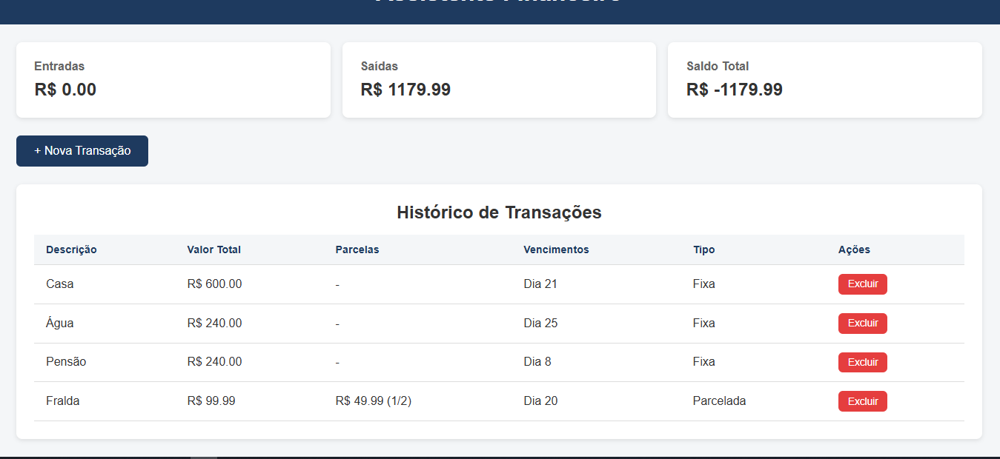
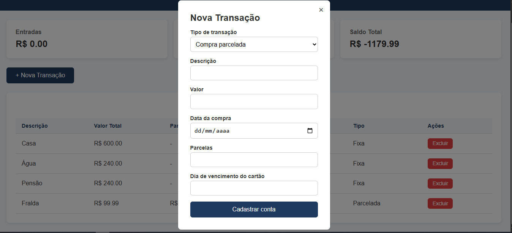

# Assistente Financeiro

Fiz esse projeto pessoal com a intenção de me ajudar na minha organização financeira, sem depender de apps genéricos e pagos de finanças.
Nessa primeira versão do programa fiz as funções básicas de cadastrar contas, separando por tipo (entradas, contas fixa e contas paceladas),
coloquei tudo que julgava ser necessário, descrição, valor, parcelas, etc... Com 3 cards de resumo para facilitar o balanço geral das contas.  

## Screenshots



## Funcionalidades
- Cadastro de conta fixa, compra parcelada e entrada
- Cálculo automático do valor da parcela
- Resumo de entradas, saídas e saldo
- Exclusão de transações
- Dados salvos no navegador (localStorage)

## Tecnologias
HTML, CSS e JavaScript puro (sem frameworks)

## Como rodar
Passo a passo: clonar o repositório, abrir o index.html no navegador.

## Estrutura do projeto

```
assistente-financeiro/
├── index.html        # Estrutura da página: cards, modal de cadastro e tabela
├── style.css         # Estilização da interface
├── script.js         # Lógica: cadastro, tabela, resumo e localStorage
├── README.md         # Documentação do projeto
└── screenshots/
    ├── tela-principal.png
    └── modal-parcelada.png
```

## O que aprendi
Manipulação do DOM, eventos, localStorage/JSON, operador ternário...

## Próximas versões
- Editar transações
- Confirmar pagamento de parcela
- Filtro por mês e alertas de vencimento

## Autor
Rafael Henrique, [link do GitHub](https://github.com/devrafael16) [LinkedIn.](https://www.linkedin.com/in/dev-rafael16/)